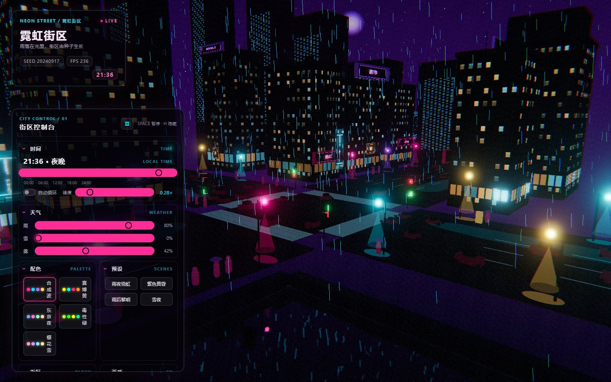
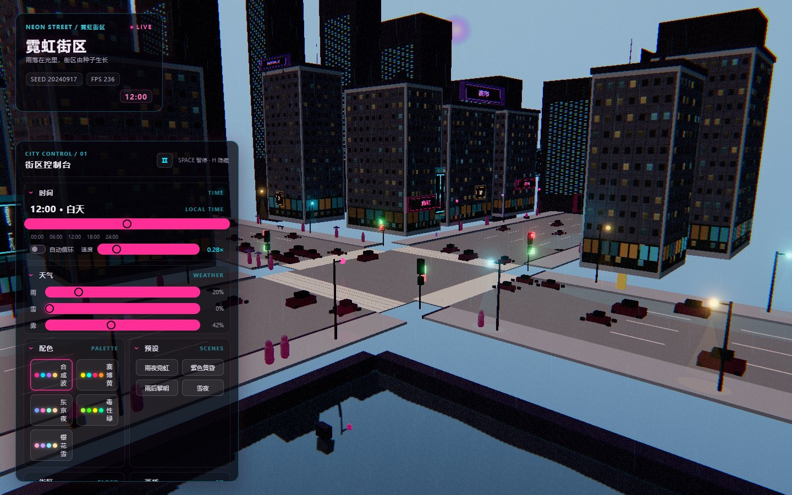

# 霓虹街区 / NEON STREET

一个由 Rust 驱动模拟、WebAssembly 传递状态、three.js 负责渲染的单页霓虹街景。街区布局由种子确定，时间、天气、灯光、招牌、水面和车辆会在浏览器中实时更新。

## 在线体验

[打开 GitHub Pages](https://sovlyn.github.io/neon_street/)



<sub>雨夜 · 合成波主题：路口信号灯、霓虹招牌、湿路面与运河倒影。</sub>



<sub>正午 · 雨后：同一街区的昼夜联动效果。</sub>

## 技术栈

- **Rust / WebAssembly**：确定性街区布局、时间与天气模拟、动态缓冲和交互状态。
- **three.js**：场景几何、车辆与行人、灯光、招牌、运河和后处理渲染。
- **Vite + TypeScript**：开发服务器、类型检查、生产构建和 GitHub Pages 静态部署。
- **Playwright**：覆盖 WASM 初始化、UI 状态、交互、URL 恢复和画布输出的端到端测试。

## 目录结构

```text
src/                 Rust 核心模拟与 wasm-bindgen 导出
web/src/              Vite 前端、three.js 场景、UI 和调试 API
web/pkg/              wasm-pack 生成物（构建时生成，不提交）
tests/               Playwright 端到端测试
docs/CONTRACT.md     模块与 DOM 调试接口契约
.github/workflows/    CI 与 GitHub Pages 部署
```

## 本地开发

环境要求：Rust、`wasm-pack`、Node.js 22+。

```bash
npm ci
npm run build:wasm
npm run dev
```

然后打开 Vite 输出的本地地址。开发页面默认使用 `http://localhost:5173/`。

## 构建与测试

```bash
# Rust 单元测试
cargo test --all

# 生成 release WebAssembly
npm run build:wasm

# TypeScript 类型检查
npm run typecheck

# 生产构建
npm run build

# 预览生产构建
npm run preview

# Playwright 端到端测试（CI 会自动安装 Chromium）
npx playwright install --with-deps chromium
npx playwright test
```

Playwright 本地配置优先使用已安装的 Chrome；CI 使用 Playwright Chromium。测试通过 `window.__neon` 和契约规定的 DOM hooks 验证真实页面行为。

## CI 与 Pages 部署

每次 push 和 pull request 会运行 `.github/workflows/ci.yml`：安装 Rust/WASM 工具链和 Node 依赖，执行 Rust 测试、WASM 构建、类型检查、Vite 构建及 Playwright 测试。失败时会尝试上传 `dist` 和 Playwright 报告。

push 到 `master` 或手动触发 `.github/workflows/deploy.yml` 会构建站点并发布到 GitHub Pages。Vite 使用相对 base，因此同一构建也可在本地预览；预期线上地址为 <https://sovlyn.github.io/neon_street/>。

## 资产与许可清单

所有建筑、道路、招牌、粒子和纹理均在运行时程序化生成；项目不使用第三方图片、模型、音频、远程 CDN 或远程字体，仅使用系统字体栈。

- three.js：MIT
- wasm-bindgen：MIT / Apache-2.0
- serde：MIT / Apache-2.0
- Vite：MIT
- TypeScript：Apache-2.0

## 已知限制

- 当前定位为桌面端体验，未针对移动端触控和小屏布局优化。
- 没有音频或音效系统。
- 种子布局目前只生成一个街区，不提供连续的多街区世界。
- 集成显卡运行高质量后处理（尤其 bloom）时可能有明显性能成本。
